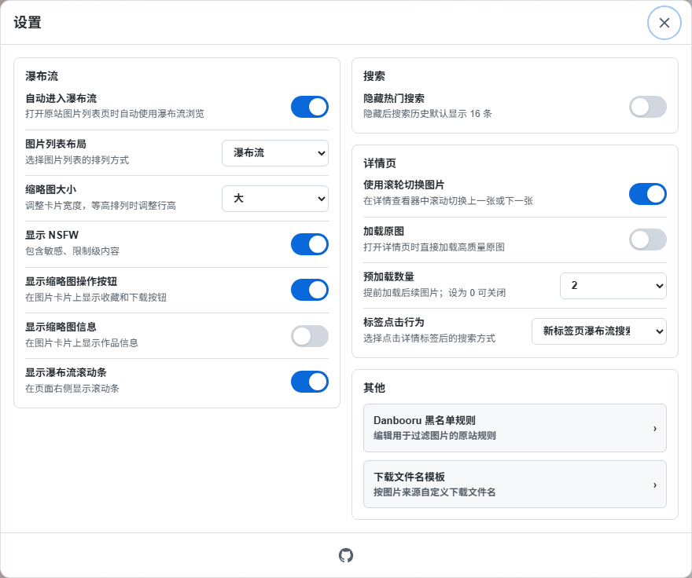
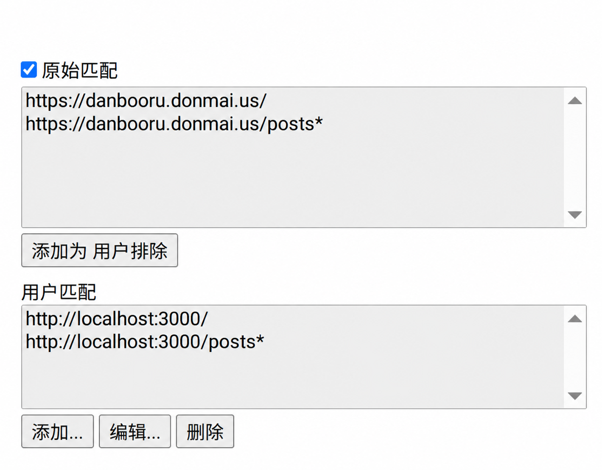

# Danbooru Masonry — Enhanced Browsing and Tag Translation

Browse Danbooru with multiple image layouts, Chinese tag translations, search history, and an immersive image and video viewer.

[中文说明](https://github.com/kano0222/danbooru-masonry/blob/main/README.md) · [Interactive preview](https://kano0222.github.io/danbooru-masonry/)

## Features

### Browsing and Layouts

- Choose masonry, grid, justified, or virtual masonry layouts.
- In masonry and virtual masonry, images taller than 2:1 show a top-aligned preview capped at twice the card width. Click to view the full image in the viewer.
- Load posts as you scroll or jump to a page, with adjustable thumbnail sizes.
- Open sources and download files from thumbnails, with optional post IDs and dimensions.
- Switch to dark mode and filter posts using your signed-in Danbooru account’s blacklist.

### Tag Search and Translation

Typing a tag shows autocomplete suggestions; selecting one inserts the tag. Queries retain their original text, with Chinese translations where available. The search bar includes Hot and personal favorites shortcuts. Tags in the original site’s left sidebar also receive Chinese translations.

### Search History and Popular Searches

Click an empty search field to view history and popular searches. Select an entry to run its complete query from page 1. Pin searches you use often, or delete entries you no longer need.

- Submitting a search, selecting history or popular searches, or searching through viewer tags records the query. Empty searches, Hot and personal favorites shortcuts, page navigation, and refreshes do not add entries.
- Up to 20 ordinary entries are kept, with recently used queries first. Use the pin to keep an entry at the top without counting toward the limit. Unpin it before deleting it. Deletion is immediate and cannot be undone.
- History initially shows eight entries and can be expanded. Enabling “Hide popular searches” in Settings shows 16 entries by default and stops requesting popular searches.
- History is stored locally in userscript storage and does not sync to your Danbooru account.

Popular searches come from Danbooru's [Popular Searches](https://danbooru.donmai.us/explore/posts/searches), with up to 10 entries. They rank search queries, unlike Hot images. If today's data is empty, the previous day is tried using UTC dates. Missing data or a failed request hides this section without affecting history.

### Image and Video Viewer

The immersive viewer supports image and video previews, navigation, zooming, favorites, downloads, and adding tags or the uploader from the current post to the blacklist. Favorites and blacklist changes require a Danbooru login.

Artist, character, and copyright tags are shown by default, with more tags available on expansion.

## Installation and Usage

[Install from Greasy Fork](https://greasyfork.org/scripts/585986) (login is required because the script is marked as adult content)

[Install from Sleazy Fork](https://sleazyfork.org/scripts/585986) (login is not required)

[Install from GitHub Release](https://github.com/kano0222/danbooru-masonry/releases/latest/download/danbooru-masonry.user.js)

Install a userscript manager (such as Tampermonkey) in your browser, then install the script from one of the links above. Automatic entry is enabled by default on first installation. Open or refresh the Danbooru home page or post list to enter masonry mode. If you disable this option in Settings, use the entry button on the original page: at the upper right on desktop, or at the top of the page on narrow screens and touch devices.

Use the language button in the toolbar to switch between Chinese and English instantly. The choice is remembered, with Chinese as the default. English mode hides Chinese translations on the original site, in the viewer, and in search, and does not load the Chinese translation resource on startup. Switching back to Chinese restores translations. Your browsing position, queries, blacklist rules, and custom filename templates are preserved.

Once inside, click the gear button in the toolbar to adjust layouts, visible information, and viewer behavior.

If Cloudflare verification appears, complete it and wait for the original site to reload.

## Usage Guide

### Settings

General options save immediately; blacklist rules and download filename templates take effect after clicking Save. Press Esc to close Settings.

- Masonry
  - Automatically enter masonry mode (enabled by default)
  - Image list layout: masonry, grid, justified, or virtual masonry (default: masonry)
  - Thumbnail size: small / medium / large (default: large)
  - Show NSFW (enabled by default)
  - Show thumbnail action buttons (enabled by default)
  - Show thumbnail information (disabled by default)
  - Show masonry scrollbar (enabled by default)
- Search
  - Hide popular searches (disabled by default)
- Viewer
  - Toolbar position: top (default) or bottom
  - Use the mouse wheel to navigate images (enabled by default)
  - Load original files (disabled by default)
  - Preload 0–5 following still images (default: 2; 0 disables preloading)
  - Tag click behavior: new-tab masonry (default) or current-tab masonry

The screenshot shows an example configuration; defaults are listed above.

### Download Filenames

Download filename templates support the following placeholders:

- `{original}`: original filename without extension
- `{artist}`: Danbooru artist tag
- `{username}`: username parsed from the source URL, falling back to the artist tag
- `{userid}`: user ID parsed from the source URL
- `{id}`: source work/post ID, falling back to the Danbooru ID
- `{postid}`: Danbooru ID

Templates use data from Danbooru and source URLs to generate filenames. Click **Save** after editing or restoring defaults.

For example, `{artist}_{postid}` combines the artist tag and Danbooru post ID. The file extension is added automatically.

### Blacklist

Sign in to Danbooru to add, remove, or batch-edit rules in Settings and save them to your account. You can also blacklist tags or the uploader of the current post through the viewer. The uploader is the account that uploaded the image and may differ from the artist. Rule editing supports tag autocomplete, and rule removals take effect after clicking Save. If rules fail to load, reopen the editor to retry.

Masonry blacklist filtering supports positive and negative tags, `*` wildcards, and `rating`, `score`, `status`, and `uploaderid` metatags; other rules are saved to Danbooru but do not apply in masonry mode.

Loading pauses when an entire page is filtered out or cannot be displayed. Scroll down again or change the page number to load the next page.

## Supported Sites and Limitations

The script supports only `https://danbooru.donmai.us` and local Danbooru instances at `http://localhost:3000` and `http://127.0.0.1:3000`. Adding user matches alone cannot enable other mirrors. See the [development guide (Chinese)](https://github.com/kano0222/danbooru-masonry/blob/main/docs/development.md#关键运行流程) for adapter details.

For URLs supported by the adapter but absent from the default script matches, also add the URL to _User matches_: script editor - Settings - Includes/Excludes - User matches - Add.

## About the Preview

Try search, layouts, the viewer, favorites, and blacklist filtering in the [interactive preview](https://kano0222.github.io/danbooru-masonry/). It uses local sample images and simulated account data without accessing a Danbooru account or the online translation service.

Settings, history, and blacklist rules use the preview site's browser storage; favorites reset on reload. Downloads save sample images, while source buttons open their original sources. To run or build the preview yourself, see the [development guide (Chinese)](https://github.com/kano0222/danbooru-masonry/blob/main/docs/development.md#本地演示与静态产物).

## Development and Plans

The [development guide (Chinese)](https://github.com/kano0222/danbooru-masonry/blob/main/docs/development.md) covers setup, local preview, project structure, validation, and the release process.

Planned improvements:

- Search sorting.
- Internationalization.

## Data Sources and Credits

- [asadahimeka/yandere-masonry](https://github.com/asadahimeka/yandere-masonry), the original project on which Danbooru Masonry is based.
- [ffdkj-Danbooru_Tag-Chinese-English-Translation-Table](https://github.com/ffdkj/ffdkj-Danbooru_Tag-Chinese-English-Translation-Table), for providing the Chinese tag translations.

This project simplifies and adapts the original project for Danbooru. Report translation errors through the [tag correction page](https://tagsuggest.zeabur.app).

## License

This project is open source under the [MIT License](https://github.com/kano0222/danbooru-masonry/blob/main/LICENSE). Preview images remain the property of their creators and are not covered by the project's MIT license; the preview's source buttons link to the original posts.

Copyright © 2026 kano0222

