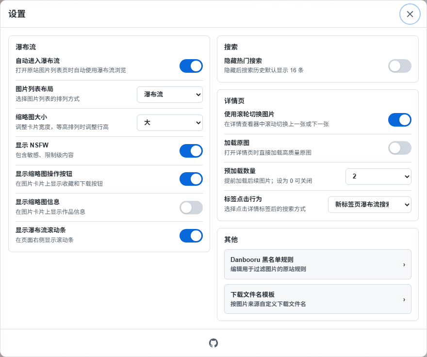
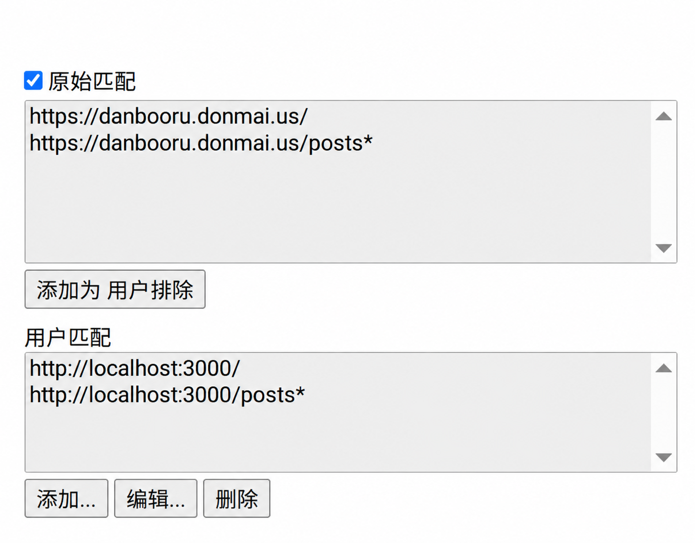

# Danbooru Masonry — 浏览增强与标签翻译

为 Danbooru 提供多种图片布局、中文标签翻译、搜索历史和沉浸式图片与视频查看。

[English](https://github.com/kano0222/danbooru-masonry/blob/main/README.en.md) · [交互预览](https://kano0222.github.io/danbooru-masonry/)

## 主要功能

### 图片浏览与布局

- 支持瀑布流、网格、等高排列和虚拟瀑布流四种布局。
- 滚动加载与页码跳转，可调整缩略图大小。
- 缩略图提供来源和下载入口，可显示图片 ID 与尺寸。
- 支持夜间模式，并按登录用户的 Danbooru 黑名单过滤图片。

### 标签搜索与翻译

输入标签时显示补全建议，点击建议填入标签；搜索条件保留原文，有译文的标签同时显示中文。搜索栏提供热门图片和个人收藏快捷入口，原站左侧标签也会自动显示中文翻译。

### 搜索历史与热门搜索

点击空搜索框查看历史和热门搜索，选择词条即可从第 1 页执行完整搜索。常用搜索可以固定，其他记录可直接删除。

- 提交搜索、选择历史或热门搜索、通过查看器标签搜索时自动记录。空搜索、热门图片和个人收藏快捷入口、翻页及刷新不新增记录。
- 普通历史最多保留 20 条，最近使用的排在前面。点击图钉可固定；固定项置顶且不计入上限，取消固定后才能删除。删除立即生效，不提供撤销。
- 历史默认显示 8 条，可展开查看更多。设置中开启「隐藏热门搜索」后默认显示 16 条，并停止请求热门搜索。
- 历史保存在本地脚本存储中，不同步到 Danbooru 账号。

热门搜索来自 Danbooru 的 [Popular Searches](https://danbooru.donmai.us/explore/posts/searches)，最多显示 10 条，是搜索词排行，与热门图片 Hot 不同。当日无数据时尝试前一天（按 UTC 日期）；无数据或请求失败时隐藏该区域，不影响历史使用。

### 图片与视频查看

沉浸式查看器支持图片和视频预览、切换、缩放、收藏、下载，以及将当前图片的标签或上传者加入黑名单。收藏和修改黑名单需要登录 Danbooru。

默认显示作者、角色和版权标签，更多标签可展开查看。

## 安装与使用

[从 Greasy Fork 安装](https://greasyfork.org/scripts/585986)（由于成人内容，需要登录才能安装）

[从 Sleazy Fork 安装](https://sleazyfork.org/scripts/585986)（不需要登录）

[从 GitHub Release 安装](https://github.com/kano0222/danbooru-masonry/releases/latest/download/danbooru-masonry.user.js)

先在浏览器中安装用户脚本管理器（如 Tampermonkey），再通过上述任一入口安装脚本。首次安装后，「自动进入瀑布流」默认开启，打开或刷新 Danbooru 首页或帖子列表即可进入。若在设置中关闭此选项，可通过原站页面右上角入口手动打开；窄屏和触屏设备的入口独占页面顶部一行，避免遮挡原站按钮。

进入后点击工具栏的齿轮按钮打开设置，可调整布局、显示内容和查看器行为。

## 使用说明

### 设置

设置集中在同一页面，桌面双栏分组，窄屏单栏滚动。普通选项修改后立即保存；黑名单规则和下载文件名模板在独立窗口中编辑，点击保存后生效。可按 Esc 关闭设置并返回齿轮按钮。

- 瀑布流
  - 自动进入瀑布流（默认开启）
  - 图片列表布局：瀑布流、网格、等高排列、虚拟瀑布流（默认瀑布流）
  - 缩略图大小：小 / 中 / 大（默认大）
  - 显示 NSFW（默认开启）
  - 显示缩略图操作按钮（默认开启）
  - 显示缩略图信息（默认关闭）
  - 显示瀑布流滚动条（默认开启）
- 搜索
  - 隐藏热门搜索（默认关闭）
- 详情页
  - 操作栏位置：顶部（默认，保持原有布局）或底部；底部模式上下翻转各区域，并反转 ID、作者等标签的纵向顺序
  - 使用滚轮切换图片（默认开启）
  - 加载原图（默认关闭）
  - 预加载后续 0–5 张静态图片（默认 2 张；0 表示关闭）
  - 标签点击行为：新标签页瀑布流搜索（默认）、当前页瀑布流搜索

底部模式将“显示标签”入口移到左上，小窗改为向右下展开。位置修改立即生效并自动保存。

设置截图为示例配置，默认值以上文为准。

### 下载文件名

下载文件名模板支持以下占位符：

- `{original}`：原文件名，不含后缀
- `{artist}`：Danbooru 作者标签
- `{username}`：来源 URL 可解析到的用户名，缺失时回退到作者标签
- `{userid}`：来源 URL 可解析到的用户 ID
- `{id}`：来源作品 ID，缺失时回退到 Danbooru ID
- `{postid}`：Danbooru ID

模板从 Danbooru 和来源 URL 获取数据生成文件名。修改或恢复默认后需点击“保存”。

例如，`{artist}_{postid}` 会使用作者标签与 Danbooru ID 组合文件名；文件后缀自动添加。

### 黑名单

登录 Danbooru 后，可在设置中添加、删除或批量编辑规则并保存到账号，也可从查看器将当前图片的标签或上传者加入黑名单。上传者指上传图片的账号，可能与作者不同；缺少上传者信息时不显示该选项。编辑规则时支持标签补全，删除规则需要确认。

瀑布流黑名单支持正负标签、`*` 通配符及 `rating`、`score`、`status`、`uploaderid` 元标签；其他规则仍会保存到 Danbooru，但不会在瀑布流中生效。

## 支持范围与限制

脚本仅支持 `https://danbooru.donmai.us` 及 `http://localhost:3000`、`http://127.0.0.1:3000` 上的本地 Danbooru 实例。其他镜像不能仅通过添加用户匹配启用，开发适配说明见[开发指南](https://github.com/kano0222/danbooru-masonry/blob/main/docs/development.md#关键运行流程)。

对适配器已支持但不在脚本默认匹配范围内的网址，还需加入 _用户匹配_（脚本编辑 → 设置 → 包括/排除 → 用户匹配 → 添加）。

## 关于预览

[交互预览](https://kano0222.github.io/danbooru-masonry/)可体验搜索、布局、查看器、收藏和黑名单过滤。预览模拟已登录状态，图片为本地示例，标签、评分、分级、上传者 ID、热门搜索和初始收藏为演示数据；操作不访问 Danbooru 账号或在线翻译服务。

设置、历史和黑名单保存在预览站点的浏览器存储中，收藏在刷新后重置。下载仅保存示例图片，来源按钮会打开原始来源。自行运行和构建预览见[开发指南](https://github.com/kano0222/danbooru-masonry/blob/main/docs/development.md#本地演示与静态产物)。

## 开发与计划

[开发指南](https://github.com/kano0222/danbooru-masonry/blob/main/docs/development.md)包含环境搭建、本地预览、项目结构、验证与发布流程。

计划改进：

- 移动版布局。
- 搜索排序。

## 数据来源与致谢

- [asadahimeka/yandere-masonry](https://github.com/asadahimeka/yandere-masonry)：Danbooru Masonry 所基于的原始项目。
- [ffdkj-Danbooru_Tag-Chinese-English-Translation-Table](https://github.com/ffdkj/ffdkj-Danbooru_Tag-Chinese-English-Translation-Table)：提供中文标签翻译数据。

本项目在原始项目基础上简化并适配 Danbooru。翻译有误时，可通过[标签纠错页面](https://tagsuggest.zeabur.app)提交反馈。

## 许可

本项目采用 [MIT License](https://github.com/kano0222/danbooru-masonry/blob/main/LICENSE) 开源。预览图片归各自创作者所有，不属于本项目 MIT 许可范围；可通过预览中的来源按钮访问原始作品。

Copyright © 2026 kano0222

